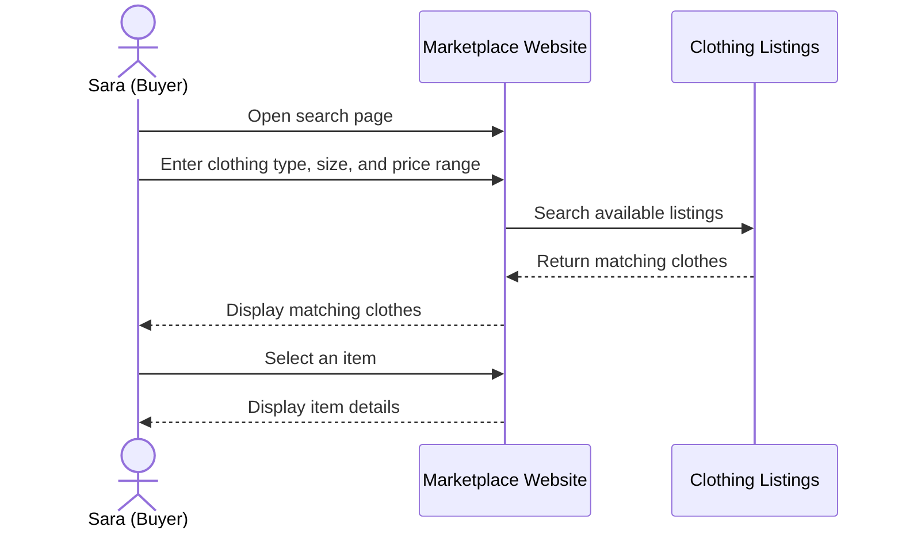

# Use Cases: Afghan Girls’ Pre-Owned Clothes Marketplace

**Project:** Afghan Girls’ Secondhand Clothes Marketplace  
**Product Owner:** Sara Qateh  
**Date:** October 13, 2026

A use case describes how a user (called an actor) interacts with a system to achieve a specific goal. For this project, the system allows girls to buy and sell pre-owned clothes online. The use cases below identify the actors, show their interactions with the system, and describe the main activities in detail.

## 1. Actors in Our System

- **Buyer (Sara):** Searches for clothes, views product details, saves favorites, and contacts sellers.
- **Seller:** Registers, uploads clothes, edits listings, and marks items as sold.
- **Admin:** Manages user accounts, reviews reported listings, and removes inappropriate content.

## 2. High-Level Use Case Diagram

The diagram shows the main actors and the actions they can perform. The system boundary represents the functions provided by our marketplace.

## 3. Detailed Use Case Table

| ID | Use Case | Actor | Description |
|---|---|---|---|
| UC-01 | Register | Buyer, Seller | Create a new account. |
| UC-02 | Log in | Buyer, Seller, Admin | Access the system using valid account details. |
| UC-03 | Browse clothes | Buyer (Sara) | View available clothes. |
| UC-04 | Search and filter | Buyer | Find clothes by size, type, price, or condition. |
| UC-05 | View item details | Buyer | View photos, price, size, condition, and seller information. |
| UC-06 | Add to favorites | Buyer | Save clothes to view later. |
| UC-07 | Contact seller | Buyer | Ask questions about an item. |
| UC-08 | Purchase item | Buyer | Request to buy a selected item and arrange the purchase. |
| UC-09 | Upload clothes | Seller | Add clothes with photos, descriptions, and prices. |
| UC-10 | Manage listings | Seller | Edit, update, or remove clothing listings. |
| UC-11 | View orders | Seller | View purchase requests and buyer details. |
| UC-12 | Manage users | Admin | Manage accounts and user access. |
| UC-13 | Manage listings | Admin | Review and remove inappropriate or invalid listings. |
| UC-14 | Handle reports | Admin | Review reports about users or products. |

> **Note:** This version assumes purchases are arranged between buyers and sellers rather than processed through an integrated payment gateway.

## 4. Detailed Use Case Description

### UC-04: Search and Filter Clothes

- **Primary actor:** Sara (Buyer)
- **Priority:** High
- **Precondition:** Sara has opened the marketplace website.

**Main flow:**

1. Sara opens the search page.
2. She enters the type of clothing she wants.
3. She selects her preferred size and price range.
4. The system searches the available listings.
5. The system displays matching clothes.
6. Sara selects an item to view its details.

**Alternative flow:** If no matching clothes are available, the system displays a message and allows Sara to change her search filters.

**Post-condition:** Sara sees matching items or receives a message that no items were found.

## 5. Sequence Diagram

A sequence diagram shows the order of messages exchanged between an actor and the system.

The example below describes Sara searching for clothes.

