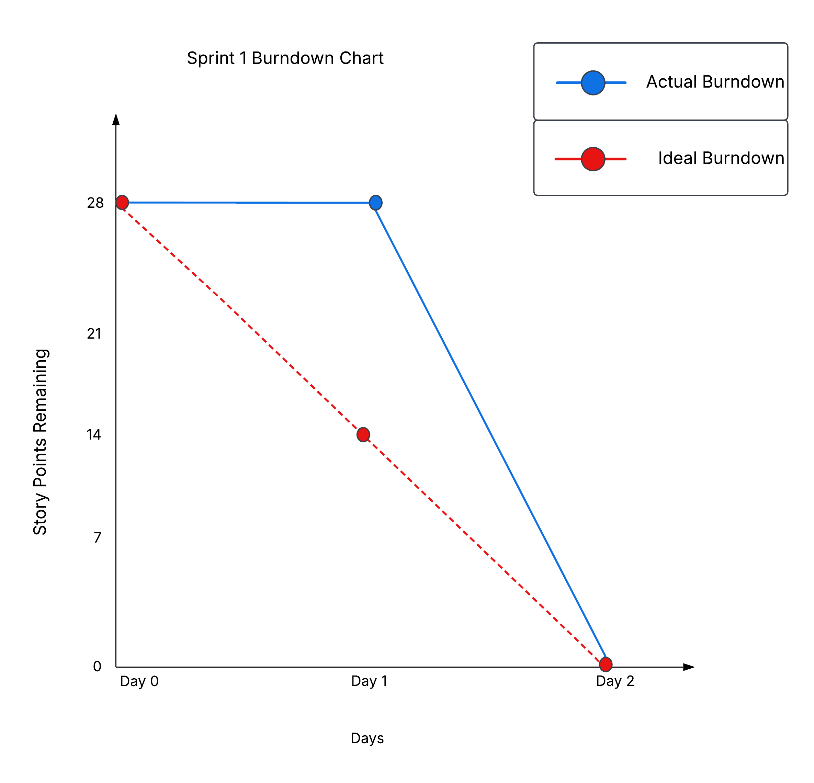

# Sprint 1 Burndown Chart

**Project:** Afghan Girls' Pre-Owned Clothes Marketplace  
**Sprint:** Sprint 1  
**Duration:** October 9-11, 2026  
**Total Story Points:** 28

---

## Daily Progress

| Date | Day | Story Points Remaining | Work Completed |
|------|-----|------------------------|----------------|
| October 9 | Day 1 | 28 | Sprint Planning, Sprint 1 requirements reviewed, and remaining work finalized |
| October 10 | Day 2 / Review | 0 | Sprint 1 features completed, demonstrated, and accepted by the Product Owner |
| October 11 | Retrospective | 0 | Sprint 1 Retrospective completed and improvements for Sprint 2 discussed |

---

## Story Points Breakdown

### US-001: Create Account (5 points)

- Signup and account creation functionality completed
- Frontend signup interface prepared
- Backend account creation connected to the database
- User information stored in the system
- Status: Completed and accepted

### US-002: Login and Logout (3 points)

- Login interface completed
- Login verification implemented
- User session handling implemented
- Logout functionality completed
- My Account functionality included
- Status: Completed and accepted

### US-003: Recently Added Clothes (5 points)

- Homepage prepared to display clothing items
- Homepage connected with listing data
- Newer clothing listings displayed first
- Status: Completed and accepted

### US-004: Clothing Categories (5 points)

- Clothing categories added to the website
- Category sections displayed on the homepage
- Users can explore different types of clothes
- Status: Completed and accepted

### NFR-001: Password Security (5 points)

- Password hashing implemented
- Passwords protected instead of being stored as plain text
- Authentication supported through the backend
- Status: Completed and accepted

### NFR-008: Simple User Interface (5 points)

- Simple website navigation created
- Clear page layout implemented
- Consistent colors and styling used
- Main website functions made easy to understand
- Product Owner gave positive feedback about the design
- Status: Completed and accepted

---

## Frontend and Backend Progress

### Frontend – Nargis Bunyadi

The main frontend work during Sprint 1 included:

- Homepage
- Website layout
- Signup page
- Login page
- Clothing categories
- My Account option
- HTML templates
- CSS styling
- JavaScript functionality
- Simple and user-friendly interface

### Backend – Parwana Jafari

The main backend work during Sprint 1 included:

- Backend routes
- Connecting backend routes with HTML pages
- Account creation logic
- Login functionality
- Logout functionality
- User session handling
- Database integration
- Password hashing
- User authentication
- Frontend and backend connection
- Recently added clothes functionality

---

## Burndown Chart Data

Points for chart:

```text
Day 0: 28
Day 1: 28
Day 2: 0
```

Ideal burndown:

```text
Day 0: 28
Day 1: 14
Day 2: 0
```

---

## 📈 Sprint 1 Burndown Chart



---

## Analysis

**Story Points Planned:** 28  
**Story Points Completed:** 28  
**Completion Rate:** 100%  
**Sprint Goal:** Achieved  
**Product Owner Acceptance:** All Sprint 1 requirements accepted  
**Test Pass Rate:** 100%  

**Velocity:**

Based on the official Sprint period, 28 Story Points were completed within the short Sprint 1 cycle.

However, this velocity should not be used as the normal baseline for future sprints because some development work had already started before the formal Sprint Planning meeting.

**Performance:**

- Sprint 1 progressed much faster than expected.
- Some development work had already started before the formal Sprint Planning meeting.
- On October 9, the team formally reviewed the Sprint 1 requirements and finalized the remaining work.
- By October 10, all planned Sprint 1 work had been completed and presented during the Sprint Review.
- All 28 Story Points were accepted by the Product Owner.
- The Sprint Retrospective was held on October 11 to discuss lessons learned and improvements for Sprint 2.

**Challenges:**

- The team had limited time to organize Sprint 1 in detail.
- Some development work started before the formal Sprint Planning meeting.
- Detailed daily Story Point tracking was not recorded from the beginning.
- A small GitHub organization issue occurred but was resolved.
- No major coding blockers prevented completion of Sprint 1.

**Outcome:** All 28 planned Story Points were completed successfully and accepted by the Product Owner.

---

## Chart Description

The Sprint 1 burndown chart shows a very fast decrease in the remaining work.

Unlike a typical sprint where Story Points decrease gradually over several days, Sprint 1 was completed in a very short period. This happened because the project timeline was limited and the developers had already started working on some parts of the website before the formal Sprint Planning meeting was held.

Because of this early development work, the team was not able to follow a detailed day-by-day Sprint schedule from the very beginning of Sprint 1.

The formal Sprint Planning meeting was held on October 9, 2026. During this meeting, the team reviewed the Sprint 1 requirements, clarified the remaining work, and confirmed what needed to be completed.

The developers then finalized the remaining Sprint 1 work quickly.

By the Sprint Review on October 10, 2026, all 28 planned Story Points had been completed and accepted by the Product Owner. Therefore, the actual burndown line dropped to zero much faster than the ideal burndown line.

The Sprint Retrospective was held on October 11, 2026. During the retrospective, the team discussed what went well, the difficulties experienced during development, and improvements for the next sprint.

Sprint 1 helped the team recognize the importance of having a clear schedule and tracking progress from the beginning of each sprint.

For Sprint 2, the team will follow a more organized Scrum schedule. Sprint Planning will be completed before development starts, daily progress will be recorded, Story Points Remaining will be updated regularly, and Daily Scrum meetings will be used to discuss completed work, current tasks, and blockers.

This will make the Sprint 2 burndown chart more accurate and will help the team follow the Scrum process more consistently.

---

**Note:** Sprint 1 officially started on October 9, 2026, with the Sprint Planning meeting. However, the developers had already started some development work before this date because of the limited project timeline.

Therefore, the burndown chart shows the official Sprint progress from October 9 onward.

For the visual burndown chart, include both the **Actual Burndown** and **Ideal Burndown** lines to compare the team's real progress with the expected progress.
