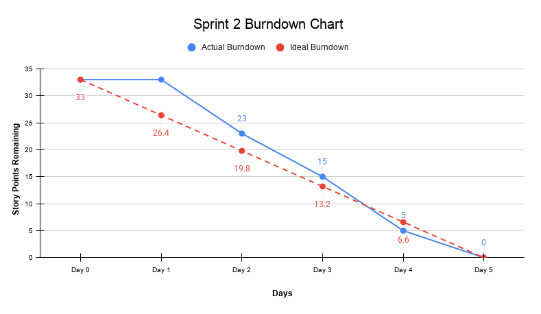

# Sprint 2 Burndown Chart

**Project:** Afghan Girls' Pre-Owned Clothes Marketplace  
**Sprint:** Sprint 2  
**Duration:** October 12-16, 2026  
**Total Story Points:** 33  

---

## Daily Progress

| Date | Day | Story Points Completed Today | Story Points Remaining | Work Completed |
|---|---|---:|---:|---|
| October 12, 2026 | Day 1 | 0 | 33 | Sprint Planning completed; development started |
| October 13, 2026 | Day 2 | 10 | 23 | US-005 Search for Clothes and US-006 Size and Price Filters completed |
| October 14, 2026 | Day 3 | 8 | 15 | US-007 Clothing Condition and US-008 Upload Product Photos completed |
| October 15, 2026 | Day 4 | 10 | 5 | US-009 Product Information and NFR-003 Input Validation completed |
| October 16, 2026 | Day 5 | 5 | 0 | NFR-002 Performance completed; final testing completed; Sprint 2 reviewed and accepted |

---

## Sprint 2 Backlog Completion

### US-005: Search for Clothes – 5 Story Points

- Completed on Day 2
- Users can search for clothing items
- Included in the completed Sprint 2 search functionality

### US-006: Size and Price Filters – 5 Story Points

- Completed on Day 2
- Users can filter clothing items by size and price
- Completed together with the search functionality

### US-007: Clothing Condition – 3 Story Points

- Completed on Day 3
- Clothing condition information was added to product listings
- Buyers can view the condition of listed clothes

### US-008: Upload Product Photos – 5 Story Points

- Completed on Day 3
- Sellers can upload product photos
- Uploaded photos are connected with clothing listings

### US-009: Product Information – 5 Story Points

- Completed on Day 4
- Required product information is included in clothing listings
- Product details are available for buyers to review

### NFR-003: Input Validation – 5 Story Points

- Completed on Day 4
- Required listing information is checked before publishing
- Incomplete required fields are prevented from being submitted

### NFR-002: Performance – 5 Story Points

- Completed on Day 5
- Final performance work and testing were completed
- Sprint 2 was ready for final review

---

## Burndown Chart Data

### Actual Story Points Remaining

    Day 0: 33
    Day 1: 33
    Day 2: 23
    Day 3: 15
    Day 4: 5
    Day 5: 0

### Ideal Burndown

    Day 0: 33
    Day 1: 26.4
    Day 2: 19.8
    Day 3: 13.2
    Day 4: 6.6
    Day 5: 0

---

## 📈 Sprint 2 Burndown Chart

---

## Progress Analysis

**Velocity:** 33 story points completed in 5 days = 6.6 story points/day average

**Performance:**

- Day 1 was mainly used for Sprint Planning and starting development.
- Strong progress was made from Day 2 onward.
- The team completed 10 story points on Day 2, 8 on Day 3, 10 on Day 4, and the final 5 on Day 5.
- By the end of Day 4, only 5 story points remained.
- All planned Sprint 2 work was completed by the end of Day 5.

**Challenges:**

- Some normal coding and integration issues appeared during development.
- A JavaScript issue affected Category Filter integration but was fixed.
- The Forgot Password feature required additional setup and library integration.
- No major unresolved blockers remained at the end of the Sprint.

**Outcome:** All 33 story points were completed successfully, the Sprint Goal was achieved, and Sprint 2 was reviewed and accepted.

---

## Burndown Performance

The actual burndown stayed above the ideal line during the early part of the Sprint because Day 1 focused on Sprint Planning and starting development.

Progress increased from Day 2 onward. By Day 4, only 5 story points remained compared with the ideal 6.6 points, placing the team slightly ahead of the ideal pace.

The final 5 story points were completed on Day 5, bringing the Sprint to 0 remaining story points.

---

## Sprint 2 Outcome

Sprint 2 was completed successfully.

- **33 story points planned**
- **33 story points completed**
- **0 story points remaining**
- **100% completion**
- **Sprint Goal achieved**
- **Sprint 2 reviewed and accepted**

All planned Sprint 2 backlog items were completed by the end of October 16, 2026.

---

## Chart Description

The Sprint 2 burndown shows steady progress from 33 story points to 0 over five days.

The actual remaining work stayed at 33 points on Day 1 and then decreased to 23 points on Day 2, 15 points on Day 3, 5 points on Day 4, and 0 points on Day 5.

The team reached zero remaining story points on the final Sprint day and completed all planned Sprint 2 work.

---

## Burndown Summary

| Metric | Result |
|---|---:|
| Planned Story Points | 33 |
| Completed Story Points | 33 |
| Remaining Story Points | 0 |
| Sprint Duration | 5 Days |
| Average Completion | 6.6 Points/Day |
| Completion Rate | 100% |
| Sprint Goal | Achieved |

---

**Note:** For a visual burndown chart, plot the Actual Story Points Remaining and Ideal Burndown values against Day 0 through Day 5.
