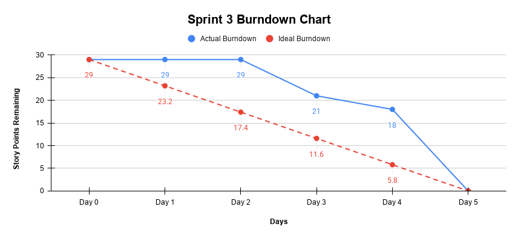

# Sprint 3 Burndown Chart

**Project:** Afghan Girls' Pre-Owned Clothes Marketplace  
**Sprint:** Sprint 3  
**Duration:** October 17-21, 2026  
**Total Story Points:** 29  

---

## Daily Progress

| Date | Day | Story Points Completed Today | Story Points Remaining | Work Completed |
|---|---|---:|---:|---|
| October 17, 2026 | Day 1 | 0 | 29 | Sprint Planning completed; development started |
| October 18, 2026 | Day 2 | 0 | 29 | Progress made on US-010 View My Listings and US-011 Edit Listing; frontend integration and testing continued |
| October 19, 2026 | Day 3 | 8 | 21 | US-010 View My Listings and US-011 Edit Listing completed; work continued on US-012 Mark as Sold |
| October 20, 2026 | Day 4 | 3 | 18 | US-012 Mark as Sold completed; work continued on US-013 Save Clothes, US-014 Contact Seller, and NFR-005 Data Reliability |
| October 21, 2026 | Day 5 | 18 | 0 | US-013 Save Clothes, US-014 Contact Seller, and NFR-005 Data Reliability completed; final testing completed; Sprint 3 reviewed and accepted |

---

## Sprint 3 Backlog Completion

### US-010: View My Listings – 5 Story Points

- Completed on Day 3
- Sellers can view their own clothing listings
- Seller Dashboard supports listing management

### US-011: Edit Listing – 3 Story Points

- Completed on Day 3
- Sellers can edit their own listings
- Updated information is saved and displayed correctly

### US-012: Mark as Sold – 3 Story Points

- Completed on Day 4
- Sellers can mark clothing items as sold
- Product status changes from Available to Sold

### US-013: Save Clothes – 5 Story Points

- Completed on Day 5
- Buyers can save clothing items they like
- Saved items remain available in the user's account

### US-014: Contact Seller – 8 Story Points

- Completed on Day 5
- Buyers can contact sellers about a specific clothing item
- Sellers can receive and view messages

### NFR-005: Data Reliability – 5 Story Points

- Completed on Day 5
- User and product data are stored and retrieved correctly
- Final data checks and testing were completed

---

## Burndown Chart Data

### Actual Story Points Remaining

    Day 0: 29
    Day 1: 29
    Day 2: 29
    Day 3: 21
    Day 4: 18
    Day 5: 0

### Ideal Burndown

    Day 0: 29
    Day 1: 23.2
    Day 2: 17.4
    Day 3: 11.6
    Day 4: 5.8
    Day 5: 0

---

## 📈 Sprint 3 Burndown Chart

---

## Progress Analysis

**Velocity:** 29 story points completed in 5 days = 5.8 story points/day average

**Performance:**

- Day 1 focused on Sprint Planning and starting development.
- Work continued on Day 2, but no backlog item was fully completed yet.
- On Day 3, US-010 View My Listings and US-011 Edit Listing were completed, reducing the remaining work from 29 to 21 story points.
- On Day 4, US-012 Mark as Sold was completed, reducing the remaining work to 18 story points.
- The remaining 18 story points were completed on Day 5.
- Sprint 3 finished with 0 story points remaining.

**Challenges:**

- Some frontend and backend integration required careful checking.
- Small naming and connection issues caused some development difficulties.
- Managing a larger amount of code made some tasks more difficult.
- The team continued testing and fixing issues during development.
- No major unresolved blockers remained at the end of Sprint 3.

**Outcome:** All 29 story points were completed successfully, the Sprint Goal was achieved, and Sprint 3 was reviewed and accepted.

---

## Burndown Performance

The actual burndown stayed above the ideal line during most of Sprint 3 because several backlog items were still in progress during the first days.

No story points were reduced on Day 1 or Day 2 because no backlog item had been fully completed yet.

Progress became visible on Day 3 when 8 story points were completed, reducing the remaining work from 29 to 21.

On Day 4, another 3 story points were completed, leaving 18 story points.

The remaining work was completed on Day 5, bringing the Sprint to 0 remaining story points.

Although much of the story point reduction happened near the end of the Sprint, all planned Sprint 3 work was completed within the Sprint period.

---

## Sprint 3 Outcome

Sprint 3 was completed successfully.

- **29 story points planned**
- **29 story points completed**
- **0 story points remaining**
- **100% completion**
- **Sprint Goal achieved**
- **Sprint 3 reviewed and accepted**

All planned Sprint 3 backlog items were completed by the end of October 21, 2026.

---

## Chart Description

The Sprint 3 burndown shows the change in remaining work from 29 story points to 0 over five days.

The actual remaining work stayed at 29 story points on Day 1 and Day 2 because backlog items were still in progress and were not yet fully completed.

The remaining work decreased to 21 story points on Day 3, 18 story points on Day 4, and 0 story points on Day 5.

The team completed all planned Sprint 3 work by the final Sprint day.

---

## Burndown Summary

| Metric | Result |
|---|---:|
| Planned Story Points | 29 |
| Completed Story Points | 29 |
| Remaining Story Points | 0 |
| Sprint Duration | 5 Days |
| Average Completion | 5.8 Points/Day |
| Completion Rate | 100% |
| Sprint Goal | Achieved |

---

**Note:** Story points were reduced only when a backlog item was fully completed, not when development work had only started.
