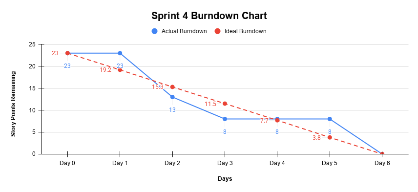

# Sprint 4 Burndown Chart

**Project:** Afghan Girls' Pre-Owned Clothes Marketplace  
**Sprint:** Sprint 4  
**Duration:** October 22-27, 2026  
**Total Story Points:** 23  

---

## Daily Progress

| Date | Day | Story Points Completed Today | Story Points Remaining | Work Completed |
|---|---|---:|---:|---|
| October 22, 2026 | Day 1 | 0 | 23 | Sprint 4 Planning completed; responsibilities confirmed; development started |
| October 23, 2026 | Day 2 | 10 | 13 | US-015 Report Listing and US-016 Review Reports completed; users can report inappropriate listings and administrators can review submitted reports |
| October 24, 2026 | Day 3 | 5 | 8 | US-017 Manage Users completed; administrator user-management functionality added, including support for managing and deactivating user accounts |
| October 25, 2026 | Day 4 | 0 | 8 | Issues found in US-017 Manage Users and the administrator view were worked on; progress on US-018 Monitor Listings and NFR-004 Administrator Access was delayed |
| October 26, 2026 | Day 5 | 0 | 8 | Continued work on US-018 Monitor Listings and NFR-004 Administrator Access; testing and issue fixing continued |
| October 27, 2026 | Day 6 | 8 | 0 | US-018 Monitor Listings and NFR-004 Administrator Access completed; final testing completed and Sprint 4 reviewed |

---

## Sprint 4 Backlog Completion

### US-015: Report Listing – 5 Story Points

- Completed on Day 2
- Users can report inappropriate or suspicious listings
- Users can provide a reason when submitting a report
- Reports are stored for administrator review

### US-016: Review Reports – 5 Story Points

- Completed on Day 2
- Administrators can view submitted reports
- Administrators can inspect reported listings
- Inappropriate listings can be removed when needed

### US-017: Manage Users – 5 Story Points

- Completed on Day 3
- Administrators can view and manage registered user accounts
- Administrators can deactivate user accounts when needed
- Additional issues found later were fixed during Sprint development

### US-018: Monitor Listings – 3 Story Points

- Completed on Day 6
- Administrators can view marketplace listings
- Listing status can be monitored
- Available, Sold, and Removed listings can be identified

### NFR-004: Administrator Access – 5 Story Points

- Completed on Day 6
- Administrator functions are restricted to authorized administrators
- Normal users cannot access administrator functions
- Administrator access was tested before Sprint completion

---

## Burndown Chart Data

### Actual Story Points Remaining

    Day 0: 23
    Day 1: 23
    Day 2: 13
    Day 3: 8
    Day 4: 8
    Day 5: 8
    Day 6: 0

### Ideal Burndown

    Day 0: 23
    Day 1: 19.2
    Day 2: 15.3
    Day 3: 11.5
    Day 4: 7.7
    Day 5: 3.8
    Day 6: 0

---

## 📈 Sprint 4 Burndown Chart

---

## Progress Analysis

**Velocity:** 23 story points completed in 6 days = 3.83 story points/day average

**Performance:**

- Day 1 focused on Sprint Planning, confirming responsibilities, and starting development.
- On Day 2, US-015 Report Listing and US-016 Review Reports were completed, reducing the remaining work from 23 to 13 story points.
- On Day 3, US-017 Manage Users was completed, reducing the remaining work to 8 story points.
- On Day 4, issues were found in Manage Users and the administrator view, so no additional story points were completed.
- On Day 5, work continued on US-018 Monitor Listings and NFR-004 Administrator Access, together with testing and issue fixing.
- On Day 6, the remaining 8 story points were completed.
- Sprint 4 finished with 0 story points remaining.

**Challenges:**

- Issues were found in Manage Users and the administrator view.
- These issues delayed progress on Monitor Listings and Administrator Access.
- The team needed additional time for testing and issue fixing.
- Sprint 4 was extended by one additional development day.
- The team continued testing the administrative functionality before final completion.
- No major unresolved blockers remained at the end of Sprint 4.

**Outcome:** All 23 story points were completed successfully, the Sprint Goal was achieved, and Sprint 4 was reviewed and accepted.

---

## Burndown Performance

The actual burndown decreased quickly during the first part of Sprint 4 when Report Listing, Review Reports, and Manage Users were completed.

On Day 1, no story points were reduced because development had only started.

On Day 2, 10 story points were completed, reducing the remaining work from 23 to 13.

On Day 3, another 5 story points were completed, leaving 8 story points remaining.

The burndown stayed at 8 story points on Day 4 and Day 5 because the team was working on administrative issues, testing, and the remaining backlog items, but those items were not yet fully completed.

The final 8 story points were completed on Day 6, bringing the Sprint to 0 remaining story points.

Because of administrative issues, Sprint 4 needed one additional development day. However, all planned Sprint 4 work was completed successfully by October 27, 2026.

---

## Sprint 4 Outcome

Sprint 4 was completed successfully.

- **23 story points planned**
- **23 story points completed**
- **0 story points remaining**
- **100% completion**
- **Sprint Goal achieved**
- **Sprint 4 reviewed and accepted**

All planned Sprint 4 backlog items were completed by the end of October 27, 2026.

---

## Chart Description

The Sprint 4 burndown shows the change in remaining work from 23 story points to 0 over six days.

The actual remaining work stayed at 23 story points on Day 1 because no backlog item had been fully completed yet.

The remaining work decreased to 13 story points on Day 2 and 8 story points on Day 3.

The remaining work stayed at 8 story points on Day 4 and Day 5 while the team worked on administrative issues, testing, and the remaining features.

On Day 6, the final 8 story points were completed, reducing the remaining work to 0.

The team completed all planned Sprint 4 work by the final Sprint day.

---

## Burndown Summary

| Metric | Result |
|---|---:|
| Planned Story Points | 23 |
| Completed Story Points | 23 |
| Remaining Story Points | 0 |
| Sprint Duration | 6 Days |
| Average Completion | 3.83 Points/Day |
| Completion Rate | 100% |
| Sprint Goal | Achieved |

---

**Note:** Story points were reduced only when a backlog item was fully completed, not when development work had only started.
