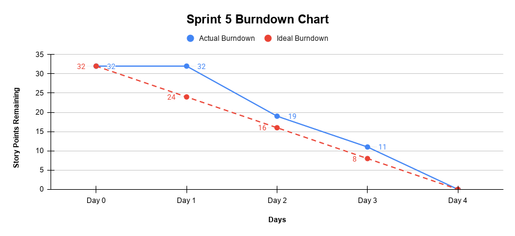

# Sprint 5 Burndown Chart

**Project:** Afghan Girls' Pre-Owned Clothes Marketplace  
**Sprint:** Sprint 5  
**Duration:** October 28-31, 2026  
**Total Story Points:** 32

---

## Daily Progress

| **Date** | **Day** | **Story Points Completed Today** | **Story Points Remaining** | **Work Completed** |
|---|---|---:|---:|---|
| October 28, 2026 | Day 1 | 0 | 32 | Sprint 5 Planning completed; responsibilities confirmed; development started |
| October 29, 2026 | Day 2 | 13 | 19 | US-019 Notifications and US-020 Mobile and Desktop Support completed; notification pop-ups and responsive support for mobile, tablet, and desktop completed |
| October 30, 2026 | Day 3 | 8 | 11 | ENHANCE-001 Improve Product Image Loading and Display and ENHANCE-002 Add Sorting Options for Clothing Listings completed; NFR-006 Browser Compatibility work continued |
| October 31, 2026 | Day 4 | 11 | 0 | ENHANCE-003 Improve the Mobile User Interface, NFR-006 Browser Compatibility, and NFR-007 Maintainability completed; final testing completed; Sprint 5 reviewed and accepted |

---

## Sprint 5 Backlog Completion

### US-019: Notifications – 5 Story Points

- Completed on Day 2
- Users can receive notifications for important account activity
- Notification support was implemented for new messages
- Users can access their Inbox from the notification
- Notification functionality was tested successfully

### US-020: Mobile and Desktop Support – 8 Story Points

- Completed on Day 2
- Main website pages were adjusted for different screen sizes
- Website functionality was checked on mobile, tablet, and desktop
- Main navigation and marketplace features work across supported screen sizes

### ENHANCE-001: Improve Product Image Loading and Display – 3 Story Points

- Completed on Day 3
- Product image display was improved
- Images were properly positioned and sized
- Clothing images display more consistently across product cards

### ENHANCE-002: Add Sorting Options for Clothing Listings – 5 Story Points

- Completed on Day 3
- Sorting options were added to clothing listings
- Users can sort by newest and oldest listings
- Users can sort by price from low to high or high to low

### ENHANCE-003: Improve the Mobile User Interface – 3 Story Points

- Completed on Day 4
- Mobile navigation and page layouts were improved
- Buttons and interface elements were adjusted for smaller screens
- Main marketplace pages were checked for mobile usability

### NFR-006: Browser Compatibility – 3 Story Points

- Completed on Day 4
- Browser compatibility testing was completed
- Main website functionality was checked across supported browsers
- Issues identified during testing were addressed before Sprint completion

### NFR-007: Maintainability – 5 Story Points

- Completed on Day 4
- Final code organization and maintainability work was completed
- Existing and new functionality was reviewed during final development
- Final integration and testing were completed before Sprint Review

---

## Burndown Chart Data

### Actual Story Points Remaining

```text
Day 0: 32
Day 1: 32
Day 2: 19
Day 3: 11
Day 4: 0
```

### Ideal Burndown

```text
Day 0: 32
Day 1: 24
Day 2: 16
Day 3: 8
Day 4: 0
```

---

## 📈 Sprint 5 Burndown Chart



---

## Progress Analysis

**Velocity:** 32 story points completed in 4 days = 8 story points/day average

**Performance:**

- Day 1 focused on Sprint Planning, confirming responsibilities, and starting development.
- On Day 2, US-019 Notifications and US-020 Mobile and Desktop Support were completed, reducing the remaining work from 32 to 19 story points.
- On Day 3, ENHANCE-001 Improve Product Image Loading and Display and ENHANCE-002 Add Sorting Options for Clothing Listings were completed, reducing the remaining work from 19 to 11 story points.
- NFR-006 Browser Compatibility also continued on Day 3.
- On Day 4, ENHANCE-003 Improve the Mobile User Interface, NFR-006 Browser Compatibility, and NFR-007 Maintainability were completed.
- Final testing was completed on Day 4.
- Sprint 5 finished with 0 story points remaining.

**Challenges:**

- Some final improvements required changes to previously developed pages and interface elements.
- Responsive improvements required checking the website across different screen sizes.
- Browser compatibility and final testing required careful checking of existing and newly added functionality.
- The team needed to make sure the final improvements did not negatively affect previous Sprint features.
- No major unresolved blockers remained at the end of Sprint 5.

**Outcome:** All 32 planned Story Points were completed successfully, the Sprint Goal was achieved, and Sprint 5 was reviewed and accepted.

---

## Burndown Performance

The actual burndown stayed at 32 story points on Day 1 because Sprint Planning was completed and development had started, but no backlog item was fully completed yet.

On Day 2, the team completed 13 story points, reducing the remaining work from 32 to 19.

This placed the actual burndown ahead of the ideal remaining value of 24 story points for Day 1 of completed development progress.

On Day 3, another 8 story points were completed, reducing the remaining work from 19 to 11.

The remaining 11 story points were completed on Day 4, bringing the Sprint to 0 remaining story points.

The team therefore completed all planned Sprint 5 work within the four-day Sprint period.

---

## Sprint 5 Outcome

Sprint 5 was completed successfully.

- **32 story points planned**
- **32 story points completed**
- **0 story points remaining**
- **100% completion**
- **Sprint Goal achieved**
- **Final testing completed**
- **Sprint 5 reviewed and accepted**

All planned Sprint 5 backlog items were completed by the end of October 31, 2026.

Sprint 5 was the final development Sprint of the project.

---

## Chart Description

The Sprint 5 burndown chart shows the change in remaining work from 32 story points to 0 over four days.

The actual remaining work stayed at 32 story points on Day 1 because Sprint Planning and the start of development did not yet result in a fully completed backlog item.

On Day 2, the remaining work decreased significantly from 32 to 19 story points after Notifications and Mobile and Desktop Support were completed.

On Day 3, the remaining work decreased from 19 to 11 story points after the Product Image Loading and Display improvement and Sorting Options were completed.

The final 11 story points were completed on Day 4 when the Mobile User Interface improvement, Browser Compatibility, and Maintainability work were finished.

Final testing was also completed on the last Sprint day.

The actual burndown reached 0 on October 31, 2026, showing that all planned Sprint 5 work was completed within the Sprint period.

---

## Burndown Summary

| **Metric** | **Result** |
|---|---:|
| Planned Story Points | 32 |
| Completed Story Points | 32 |
| Remaining Story Points | 0 |
| Sprint Duration | 4 Days |
| Average Completion | 8 Points/Day |
| Completion Rate | 100% |
| Sprint Goal | Achieved |
| Final Status | Completed |

---

**Note:** Story Points were reduced only when a backlog item was fully completed, not when development work had only started.
